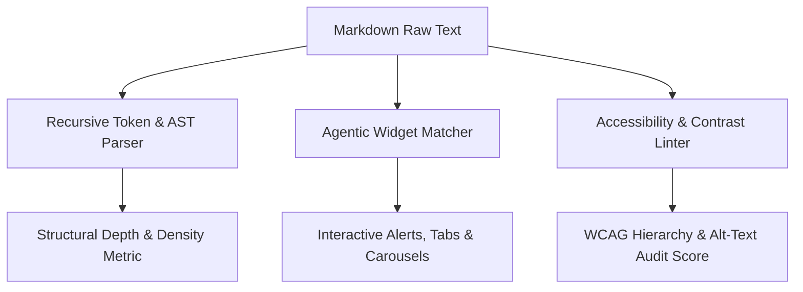

# genpark-agentic-markdown


GenPark Agentic Markdown is a zero-dependency CommonMark AST parsing, interactive widget transformation, and accessibility compliance engine designed for autonomous agent doc generation and markdown artifact rendering.



## Features
- **Recursive AST Tokenizer**: Measures nesting depth, code block integrity, and information density without external markdown libraries.
- **Interactive Agentic Directives**: Transforms `:::alert`, `:::tabs`, and `::::carousel` markup into responsive HTML widgets.
- **Accessibility Linter**: Detects heading level skips, empty image alt tags, and vague hyperlink anchor text.

## Quickstart

```python
from client import GenParkAgenticMarkdown

gam = GenParkAgenticMarkdown()
res = gam.parse_ast_token_density_and_depth("# Hello\n\n```python\npass\n```")
print("Density:", res["structural_density_pct"], "%")
```

## License
MIT
